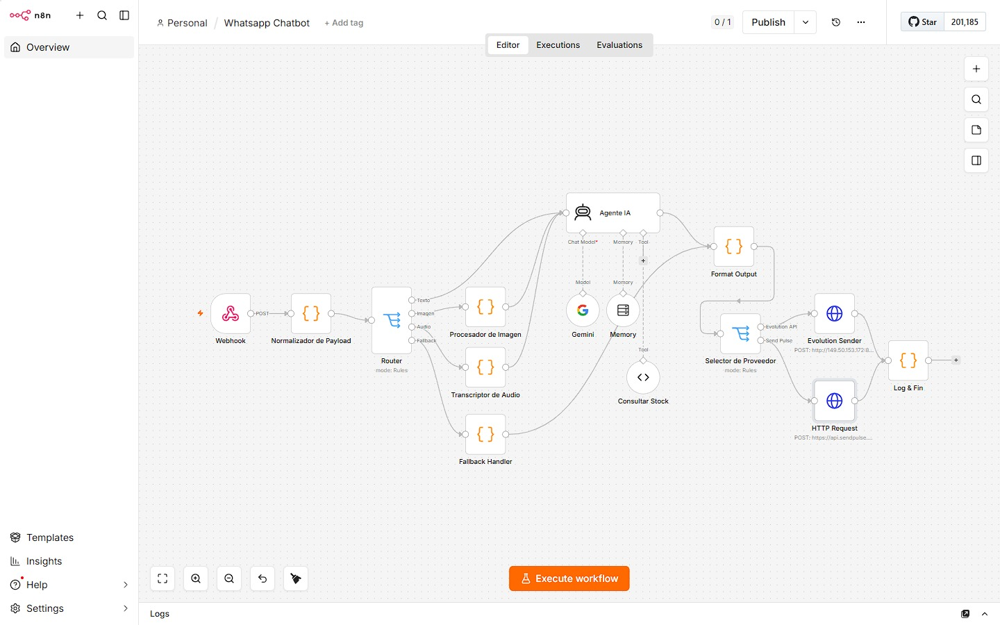

# 🤖 Agente IA Multimodal para WhatsApp (n8n + Gemini + Evolution API)

Flujo de automatización en **n8n** diseñado para atención al cliente y consulta de stock en tiempo real a través de WhatsApp. Procesa mensajes multimodales (texto, audio e imágenes) mediante enrutamiento inteligente y memoria conversacional.

## ⚙️ Arquitectura del Flujo

1. **Ingesta y Normalización (`Webhook` → `Normalizador de Payload`):** Recibe los eventos entrantes desde WhatsApp y estandariza la estructura del mensaje.
2. **Enrutamiento Multimodal (`Router`):** Clasifica el tipo de entrada en 4 ramas:
   - **Texto:** Pasa directo al agente.
   - **Imagen (`Procesador de Imagen`):** Extrae contexto visual del producto o comprobante.
   - **Audio (`Transcriptor de Audio`):** Convierte notas de voz a texto antes de procesarlas.
   - **Fallback (`Fallback Handler`):** Gestiona formatos no soportados.
3. **Núcleo de Inteligencia (`Agente IA`):**
   - **Modelo:** Google Gemini.
   - **Memoria:** Mantiene el hilo de la conversación por usuario.
   - **Tools (`Consultar Stock`):** Herramienta conectada para validar disponibilidad de productos en tiempo real.
4. **Formateo y Despacho (`Format Output` → `Selector de Proveedor`):** Adapta la respuesta y la envía vía **Evolution API** (o proveedor HTTP alternativo), finalizando con registro de logs (`Log & Fin`).

## 🚀 Cómo importarlo en tu instancia de n8n

1. Descarga el archivo [`Whatsapp-Chatbot-N8N.json`](./Whatsapp-Chatbot-N8N.json) de este repositorio.
2. En tu panel de n8n, crea un nuevo workflow, haz clic en el menú superior derecho (`...`) → **Import from File**.
3. Configura tus credenciales de **Google Gemini** y actualiza los endpoints de **Evolution API** y **Stock** en los nodos correspondientes.